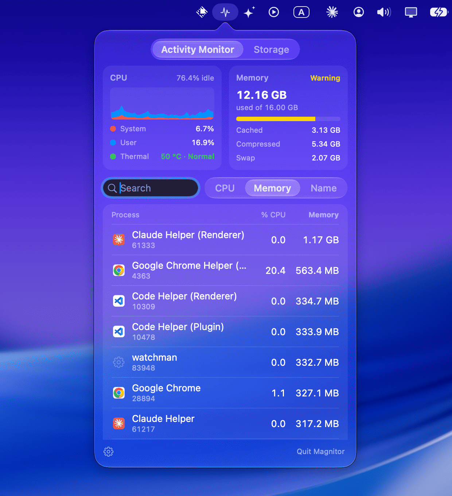
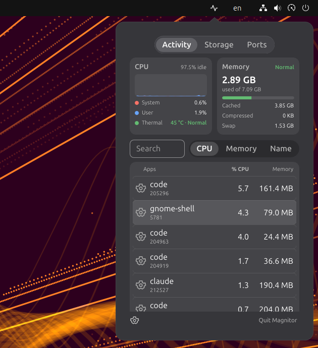

<div align="center">


# Magnitor

**Your computer's vitals, one click away in the menu bar or tray.**

Live CPU, memory and thermal readings, a searchable process list, and a disk-space breakdown, in a native app for the macOS menu bar and the Linux tray.

[](https://github.com/rothxz/magnitor/actions/workflows/release.yml)


<br />

<a href="https://github.com/rothxz/magnitor/releases/latest/download/Magnitor.dmg"></a>

<sub>Signed and notarized · macOS 14 Sonoma or later</sub>

<sub><b>Linux:</b> <a href="#getting-started">build from source</a>, or download the <a href="https://github.com/rothxz/magnitor/releases/latest/download/Magnitor-linux-x86_64.tar.gz"><code>linux-x86_64</code> tarball</a> from the latest release</sub>

<br />
<br />

<table>
<tr>
<td align="center"></td>
<td align="center"></td>
</tr>
<tr>
<td align="center"><sub>macOS menu bar</sub></td>
<td align="center"><sub>Linux tray (Ubuntu, GNOME)</sub></td>
</tr>
</table>

</div>

---

## Features

### Activity Monitor
- **CPU at a glance:** a live graph split into System and User load, with idle percentage.
- **Thermal state:** CPU temperature and macOS thermal pressure (Normal, Fair, Serious, Critical). On Linux the temperature comes from the kernel's hwmon sensors (`coretemp`, `k10temp`, `zenpower`, or a system-on-chip's).
- **Memory breakdown:** used vs. total, with Cached, Compressed and Swap, and a pressure indicator that turns to *Warning* when memory runs low.
- **Process list:** every running process with its app icon, PID, % CPU and memory. Search it, and sort by CPU, Memory or Name.
- **Process details:** open a process to see its parent, threads, CPU time and real memory, then **Quit** or **Force Quit** it.

### Storage
- **Where the space went:** a pie chart of your home folder by size, measured on a thread per core so large folders don't stall the UI.
- **Drill down:** open any folder to see what it holds, or **Show in Finder**.
- **Developer Files:** finds your projects' build folders (`node_modules`, `target`, `.next`, `Pods`, `.venv`, Elixir, Haskell, CMake and more) and about 25 tool caches (Xcode, npm, Homebrew, Gradle, Cargo…), suggests what is safe to clear, and moves it to the Trash so Finder's **Put Back** still works. **Delete Now** then frees the space without touching anything else in the Trash. Go's module cache, Docker and old simulators are cleared with their own commands (`go clean -modcache`, `docker system prune`, `xcrun simctl delete unavailable`), each run only after you confirm. Add folders on other drives, or leave folders out, in Settings.

### Ports
- **What's listening:** the TCP ports your processes listen on, development servers first and named for what you started (`vite`, `next dev`), with a warning on one open to your network.
- **Docker containers by name:** a container's published port shows its name, compose project and image; **Stop** stops that container, not Docker.
- **Act on a server:** open it in the browser, copy its URL or command, show its folder, stop or force stop it. ↑ ↓, Enter and ⌘K work as in Activity Monitor.

### Always on
- **Menu bar icon:** choose Waveform, Gauge, Chip, Memory, Disk or Pie Chart, and choose what the menu bar item shows.
- **Alerts:** get notified when CPU or memory stays above a threshold for a set time, or when free disk space drops too low; when one app or process stays busy (a runaway build, a stuck `node`) or its memory keeps growing (a leak); and once a month when developer files you can clean up pass a size you choose. Clicking an alert opens Magnitor at what it is about.
- **Desktop widget:** small and medium widgets with CPU, memory pressure and free disk space.
- **Global keyboard shortcut:** open Magnitor from anywhere.
- **Automatic updates:** checks GitHub Releases at launch and every six hours, then installs and relaunches in one click. Each update is verified against Magnitor's own Developer ID signature before it replaces the app.

### On Linux

Magnitor runs on x86_64 Linux; it is tested on Ubuntu with GNOME on Wayland. It reads processes, memory and ports from `/proc` and temperatures from `/sys/class/hwmon`, and its tray icon is a StatusNotifierItem: KDE Plasma shows it as is, and GNOME needs the AppIndicator extension, which Ubuntu turns on by default. The global shortcut goes through the desktop portal. A few parts are macOS-only for now:

- The desktop widget, and installing updates: Linux builds can check GitHub Releases, but updates install only on macOS, where each is verified against Magnitor's Developer ID signature.
- The Ports tab lists only your own processes' ports: the system's services and Docker's published ports belong to root.

## Requirements

| | |
|---|---|
| **OS** | macOS 14 Sonoma or later, or Linux (x86_64) |
| **Runtime** | [Bun](https://bun.sh) |
| **Toolchain** | Rust (pinned by `rust-toolchain.toml`); on macOS, Xcode command-line tools too |
| **SDK** | The Exact framework, checked out next to this repo at `../exact` (set `EXACT` to use another path) |

Run `bun ../exact/scripts/exact.mjs setup --check` to see what a native build still needs.

## Getting started

```bash
git clone https://github.com/rothxz/magnitor.git
cd magnitor
bun install

# Build and launch the macOS app
bun run dev            # same as: bun exact.mjs mac --run

# Build and launch the Linux app
bun run dev:linux      # same as: bun exact.mjs linux && ./target/host-dev/magnitor-linux
```

Magnitor runs as a menu bar accessory: look for its icon in the menu bar (or the tray on Linux), not the Dock.

Linux support needs Exact changes that aren't upstream yet. CI applies them from [`.ci/exact-patches-linux`](.ci/exact-patches-linux); for a local build, apply the same patch to your `../exact` checkout:

```bash
git -C ../exact checkout 7c48f38f1b1829ca2643cdfd0aadabf5ada58c05
git -C ../exact apply "$PWD"/.ci/exact-patches-linux/*.patch
```

### Other commands

| Command | What it does |
|---|---|
| `bun exact.mjs mac` | Build the macOS app without launching it |
| `bun exact.mjs linux` | Build the Linux app; prints the binary's path |
| `bun exact.mjs web` | Web dev loop with reload on save |
| `bun exact.mjs test` | Run the `*.test.contract` UI tests |
| `bun exact.mjs verify` | Build, test, and check every screen in light and dark mode |
| `bun exact.mjs help` | List every available command |

## How it works

Magnitor is built with **Exact**: a declarative view and a typed contract, backed by Rust and TypeScript data sources.

```
app.contract        The UI: menu bar popover, tabs, settings and the widget
app.ts              TypeScript sources: disk size (df), app names (Spotlight),
                    Show in Finder (open), widget state
data/               Rust crate `magnitor-data`, running on its own worker thread
  src/walk.rs         Parallel folder walk for the Storage tab
  src/tasks.rs        Process list, details and quit/force quit
  src/vitals.rs       CPU, memory and pressure readings
  src/sensors.rs      Thermal state and CPU temperature (hwmon on Linux)
  src/sample.rs       Process sampling (/proc on Linux)
  src/ports.rs        Listening ports
  src/icons.rs        App icons for processes
app.test.contract   UI tests
app.json            Manifest: name, bundle id, macOS window, widget
```

The heavy work (walking many gigabytes of folders and sampling processes) runs in Rust on a dedicated worker thread, so the popover stays responsive.

### Privacy

Magnitor runs entirely on your computer and makes no network requests other than checking GitHub Releases for a new version, which you can turn off in Settings. Its permissions are declared up front in [`app.ts`](app.ts): it can run only `df`, `mdfind`, `mdls` and `open`, and send notifications.

## Contributing

Issues and pull requests are welcome. Before you open a PR, run:

```bash
bun exact.mjs verify
```

and make sure it reports `verify: clean`.

---

<div align="center">
<sub>Built with Exact · Rust · TypeScript</sub>
</div>
